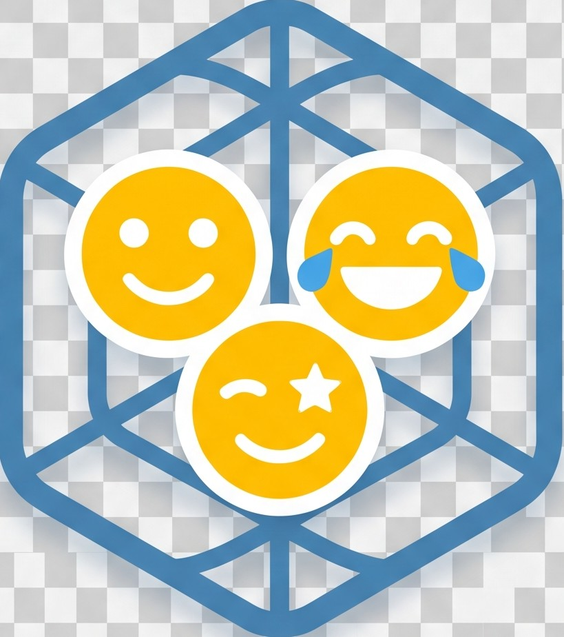

<p align="center">
  
</p>

# Mojinest

自部署、跨平台的个人表情包 / 梗图统一管理系统。
散落在 QQ、微信、企业微信里的收藏，全部收进一个属于你自己的小窝：原生桌面端快捷唤出、点选即贴、Web 端多端自适应互通、AI 视觉自动打标与分类、微信 4.x 动图无损转码解密。

- **后端引擎**：Go（单文件、无 CGO、pure-Go SQLite，支持 Docker 极简部署）
- **桌面客户端**：Tauri v2 + Rust（Windows / Linux 原生，WebView2 渲染，极低内存占用）
- **Web 端体验**：内嵌式响应式极简暗黑 SPA，支持全屏自适应铺满、移动端适配与无限滚动分页
- **存储架构**：支持本地隔离存储或无缝切换 Cloudflare R2 / S3 兼容对象存储，空间完全物理隔离
- **AI 视觉分类**：接入任意 OpenAI 兼容多模态模型（如 Gemini / GPT-4o），自动打标与标准大类归纳

---

## 核心特性

### 1. 现代原生桌面端 (Tauri v2)
- **全局快捷键呼出**：默认 `Ctrl+Alt+E`（可自由配置），在任意聊天窗口按下即刻唤起/隐藏表情面板；
- **右键矩形框选多选**：支持直接按住鼠标右键拖拽框选表情包，并支持 `Ctrl` / `Shift` 累加多选；原地单击无缝保留右键菜单；
- **智能点选与聊天气泡缩放**：
  - 点击卡片下 1/3 区域「复制」按钮，等比缩放至标准表情包尺寸（长边 ≤ 240px），完美贴合 QQ/微信聊天气泡；
  - 点击卡片主体区域进入选中/多选模式，底部常驻多选计数与「取消多选」胶囊；
  - 批量删除带 5 秒后悔撤回保护，删除瞬间自动退场多选栏，撤销提示置顶防误触；
- **无损剪贴板直写**：Windows 底层采用 `DataObject` 文件 + 位图双通道直写，微信/QQ 粘贴 100% 作为原生动态表情发送；
- **微信 4.x 动图无损提取与解密**：
  - 原生提取微信私有 `wxgf` 格式裸 HEVC/H.265 视频流，客户端本地自动转码为通用 `GIF89a` 动图入库，彻底告别微信导出动图变静态缩略图的问题。

### 2. 全功能 Web 端 (与桌面端 100% 对齐)
- **多端响应式自适应**：宽屏下卡片弹性铺满整屏不留白边，移动端与平板自动折行；
- **触底无限滚动分页**：首屏智能补足，下滑触底无感平滑追加下一页；
- **全套交互对齐**：支持右键框选多选、批量撤回删除、分类标签统计联动、拖拽上传与剪贴板写入兼容。

### 3. AI 视觉打标与分类
- **可视化动态配置**：桌面端/Web端设置面板中可直接配置模型 API 端点、密钥、模型名，支持一键连通性测试；
- **大类标签收敛**：通过约束提示词从标准大类（沙雕搞笑、阴阳吐槽、可爱萌系、日常等）自动打标归类，支持一键批量重打与补标。

---

## 部署教程

### 方式一：Docker / Docker Compose（推荐）

项目根目录已提供 `docker-compose.yml`：

```bash
# 启动服务
docker compose up -d

# 查看日志
docker compose logs -f
```

默认服务将在 `http://<服务器IP>:18642` 启动，数据与配置持久化保存在当前目录下的 `./data` 文件夹。

---

### 方式二：二进制编译运行

#### 依赖环境
- Go 1.22+
- Make

#### 1. 编译并运行服务端
```bash
# 编译服务端
make build

# 启动服务端（默认读取当前目录 config.json 或 ~/.config/mojinest/config.json）
./mojinest -config config.json
```

---

### 方式三：编译 Tauri 桌面客户端

#### 依赖环境
- Rust 1.75+
- Node.js 18+

#### 1. Linux 交叉编译 Windows 版 (x86_64-pc-windows-msvc)
```bash
cd client-desktop/src-tauri
cargo xwin build --target x86_64-pc-windows-msvc --release
```
编译产物位于：
`client-desktop/src-tauri/target/x86_64-pc-windows-msvc/release/mojinest-desktop.exe`

#### 2. Windows 本地编译
```bash
cd client-desktop/src-tauri
cargo build --release
```
编译产物位于：
`client-desktop/src-tauri/target/release/mojinest-desktop.exe`

---

## 使用教程

### 1. 服务端配置与初始化
首次启动会自动在指定目录生成数据文件夹，`config.json` 基础示例：
```json
{
  "addr": "0.0.0.0:18642",
  "data_dir": "./data",
  "auth_token": "your-secure-token",
  "storage_backend": "local",
  "ai": {
    "api_base": "http://127.0.0.1:7861/antigravity/v1",
    "api_key": "your-api-key",
    "model": "gemini-3.8-flash-medium",
    "batch_size": 5
  }
}
```

### 2. 访问 Web 端
打开浏览器，访问：
`http://<服务器IP>:18642?token=your-secure-token`
- 浏览器会自动持久化 Token；
- 页面支持拖拽图片直接上传入库、按住右键框选批量管理。

### 3. 使用桌面客户端
1. 启动 `mojinest-desktop.exe`（可重命名为 `Mojinest.exe`）；
2. 点击右上角齿轮图标打开「设置」：
   - 填写服务端地址（例如 `http://192.168.1.4:18642`）和 Token；
   - 设置全局唤起快捷键（默认 `Ctrl+Alt+E`）；
   - 设置 AI 视觉模型连接；
3. 按下快捷键呼出窗口，点击表情包下方的「复制」，即可在微信/QQ 中直接 `Ctrl+V` 发送表情！

---

## 项目结构

```
├── cmd/
│   └── mojinest/           # 服务端入口主程序
├── client-desktop/         # Tauri v2 原生桌面端
│   ├── src/                # 桌面端现代化暗黑 UI
│   └── src-tauri/          # Rust 核心（快捷键、托盘、剪贴板注入、微信解密）
├── internal/
│   ├── api/                # RESTful API 路由及动态配置管理
│   ├── config/             # 配置管理及路径规范
│   ├── db/                 # SQLite 存储抽象
│   ├── imageutil/          # 图片解码、转码、缩略图生成
│   ├── repo/               # 数据访问仓储层
│   ├── tagger/             # AI 视觉打标器与 Prompt
│   ├── webui/              # 内嵌式 Web 前端资源
│   └── worker/             # 后台异步队列与任务消费
├── Makefile                # 自动化编译脚本
└── docker-compose.yml      # Docker 编排文件
```

---

## 开源协议

本项目采用 [MIT License](LICENSE) 开源协议。
